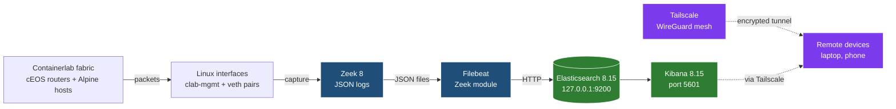
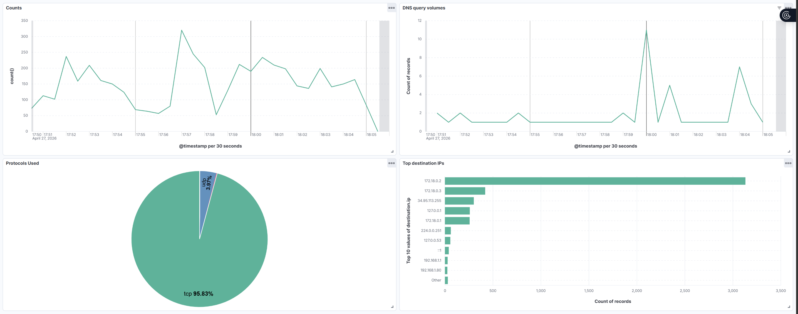

# Phase 4: Security and observability (Zeek + ELK + Tailscale)

Monitoring and remote access on top of the EVPN fabric. Three separate pieces:

- Zeek, a passive sensor on the lab VM that writes JSON logs for every connection it sees
- Filebeat, Elasticsearch and Kibana, which ship, index and chart those logs
- Tailscale, a WireGuard mesh VPN for getting to the lab from anywhere without port forwarding

## Architecture



## Files

- `docker-compose.yml`: Elasticsearch and Kibana 8.15.0. On the lab VM it lives in `~/elk-stack/`.
- `filebeat.yml`: goes in `/etc/filebeat/filebeat.yml`. Enables the Zeek module for conn, dns, notice, weird and capture_loss logs.
- `phase4-dashboard.png`: the Kibana dashboard.



## Zeek

Installed from the openSUSE Build Service repo for Ubuntu 24.04, so it lives in `/opt/zeek`. Two config changes:

- `/opt/zeek/etc/node.cfg`: `interface=any`, so it captures on every interface on the VM
- `/opt/zeek/share/zeek/site/local.zeek`: `@load policy/tuning/json-logs.zeek` at the bottom, so logs are JSON instead of TSV

Started with `sudo /opt/zeek/bin/zeekctl deploy`. Logs land in `/opt/zeek/logs/current/`:

- `conn.log`: every TCP, UDP and ICMP flow
- `dns.log`: DNS queries and answers
- `weird.log`: protocol oddities. The VXLAN traffic between leaves shows up here, because Zeek's default config doesn't decode the inner packets.
- `notice.log`: security notices
- `capture_loss.log`: packet capture loss

## Elasticsearch, Kibana and Filebeat

- Elasticsearch runs single node with security off, so it is bound to `127.0.0.1:9200` only. Heap is fixed at 1 GB. Data is in a named volume.
- Kibana is bound to `0.0.0.0:5601` so it's reachable from the LAN and over Tailscale.
- Filebeat runs on the host, not in Docker, because it needs to read `/opt/zeek/logs/current/` directly. After writing the config, `sudo filebeat setup --modules zeek` loads the index templates, ingest pipelines and stock dashboards once, then `sudo systemctl enable --now filebeat`.

The dashboard "Network Observability - Phase 4" has four Lens panels:

- connections over time (line, count of records over `@timestamp`)
- top destination IPs (horizontal bar, top 10 `destination.ip`)
- protocol split (pie, `network.transport`)
- DNS queries over time (line, filtered on `event.dataset : "zeek.dns"`)

## Tailscale

Installed with the official script and joined to a personal tailnet with GitHub sign-in. The VM gets a fixed 100.x.y.z address that any device on the same tailnet can reach. I tested:

- SSH to the lab VM from a laptop on a phone hotspot
- Kibana from a phone on cellular data

Traffic is end-to-end WireGuard. Nothing is forwarded on the home router.

## Management bridge name

Zeek and any other host tool need a predictable interface name, so the topology pins the Containerlab management bridge:

```yaml
mgmt:
  network: clab-mgmt
  bridge: clab-mgmt
  ipv4-subnet: 172.20.20.0/24
```

Without it Containerlab makes a new `br-<random>` bridge on every deploy.

## Resources

| Component | Memory |
|---|---|
| 3 cEOS containers | about 4 GB |
| Elasticsearch | about 1.5 GB (1 GB heap plus overhead) |
| Kibana | about 500 MB |
| Zeek, Filebeat, Tailscale | under 500 MB together |

I resized the lab VM from 8 GB / 4 cores to 12 GB / 6 cores for this phase. It was a two-line change in `variables.tf`, and `terraform plan` showed `0 to add, 1 to change, 0 to destroy`, so the VM was updated in place.

## Security notes

Elasticsearch has no authentication here. That's fine on a single VM where it only listens on localhost. Kibana, on the other hand, listens on every interface and also has no login. On a shared network such as a school lab, either bind Kibana to `127.0.0.1` and reach it over Tailscale or an SSH tunnel, or turn on `xpack.security` and set passwords.

## Lessons learned

- Zeek on the management bridge missed all the data plane traffic. Containerlab wires the fabric links as direct veth pairs, so they never touch the bridge. `interface=any` catches both.
- Host-to-host traffic across the overlay shows up as outer UDP/4789 flows between the leaf loopbacks, not as 10.100.100.x conversations. Decoding the inner packets needs extra Zeek config, which I left out of scope.
- Zeek pulls in postfix as a dependency. Pick "No configuration" in the install dialog.
- `/opt/zeek/logs/current/` is `root:zeek` with mode `drwxr-sr-x`. Filebeat runs as root by default so it can read it. A non-root Filebeat would need `usermod -a -G zeek filebeat`.
- A single-node Elasticsearch can't place replica shards, so indices stay yellow forever unless the template sets `index.number_of_replicas: 0`.
- Everything that joins the tailnet has to sign in with the same identity provider. A device signed in with Google ends up in a different tailnet from one signed in with GitHub.
